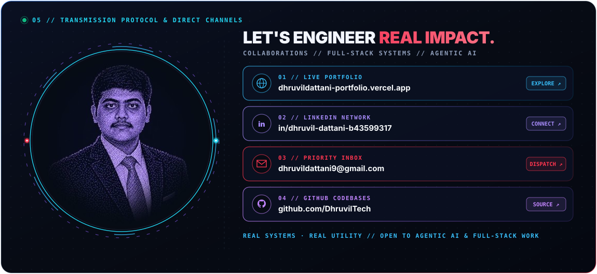
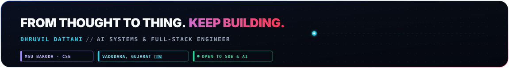

<!-- ╔══════════════════════════════════════════════════════════════════════╗
     ║  Dhruvil Dattani — GitHub Profile README                           ║
     ║  github.com/DhruvilTech                                            ║
     ║  Cyberpunk HUD · 3D Builder Pass · Live Real-Time Analytics        ║
     ║  Palette: bg #070b16  cyan #22d3ee  violet #8b5cf6  coral #ff354f ║
     ╚══════════════════════════════════════════════════════════════════════╝ -->

<a id="dhruvil-dattani"></a>

<!---------------------------------------------------------------------------->
<!-- HERO — Profile Showcase Card with Live 5-Phase Halftone Morph             -->
<!---------------------------------------------------------------------------->

<div align="center">

<picture>
  <source media="(prefers-color-scheme: light)" srcset="assets/hero-terminal.svg">
  
</picture>

</div>

<br/>

<br/>

<!-- ANIMATED SECTION DIVIDER -->
<div align="center">
  
</div>

<br/>

<!---------------------------------------------------------------------------->
<!-- 1. BUILDER CREDENTIALS — 3D HANGING LANYARD PASS & SKILLS RADAR          -->
<!---------------------------------------------------------------------------->

<a id="credentials"></a>

## 🪪 Technical Credentials & Tech Stack

<div align="center">

<picture>
  <source media="(prefers-color-scheme: light)" srcset="assets/builder-pass.svg">
  
</picture>

</div>

<br/>

<!-- ANIMATED SECTION DIVIDER -->
<div align="center">
  
</div>

<br/>

<!---------------------------------------------------------------------------->
<!-- 2. FEATURED PRODUCTION PROJECTS                                           -->
<!---------------------------------------------------------------------------->

<a id="projects"></a>

## 🚀 Projects

> **Engineering Standard:** Problem Identified → Architectural Solution → Measurable Real-World Impact

<br/>

### 01 — DocShield AI · Enterprise Document Forensics & Tampering Detection

```
  ▸ CHALLENGE    : Manual KYC verification fails against sophisticated digital forgeries,
                   pixel manipulation, and deepfake identity impersonation.

  ▸ ARCHITECTURE : Dual-pipeline forensic screening engine running Error Level Analysis (ELA),
                   copy-move clone detection, font inconsistency scoring, and facial
                   biometric matching with AES-256-GCM client-side encryption.

  ▸ KEY IMPACT   : Real-time pixel tampering heatmaps, biometric face-match cross-validation,
                   instant risk scoring verdict, and automated compliance audit reports.
```

<details>
<summary>🔬 <b>Technical Deep-Dive & Pipeline Breakdown</b></summary>
<br/>

- **Client Enclave:** React 19 UI with client-side zero-knowledge AES-256-GCM encryption before upload.
- **Forensic Pipeline:** Multi-signal OpenCV and deep CNN models extracting localized noise fingerprints, compression artifacts, and clone regions.
- **Biometric Matching:** Facial landmark distance analysis validating selfie portrait against ID document photo.
- **Secure Vault:** Encrypted Cloudinary artifact storage and pure SQL MySQL 8.0 audit history logs.

</details>

<br/>

**Core Engineering:** `Forensic Error-Level Analysis` · `Copy-Move Forgery Detection` · `Facial Landmark Biometrics` · `AES-256-GCM Encryption` · `FastAPI Async Pipeline` · `React 19 Frontend`

<br/>

**Stack:** <a href="https://github.com/DhruvilTech/DocShield-AI"></a> <a href="https://github.com/DhruvilTech/DocShield-AI"></a> <a href="https://github.com/DhruvilTech/DocShield-AI"></a> <a href="https://github.com/DhruvilTech/DocShield-AI"></a> <a href="https://github.com/DhruvilTech/DocShield-AI"></a>

<br/><br/>

<a href="https://github.com/DhruvilTech/DocShield-AI">
  
</a>

---

### 02 — InternX AI · AI-Powered Career & Virtual Internship Ecosystem

```
  ▸ CHALLENGE    : Students struggle to bridge the gap between academic coursework and industry,
                   facing fragmented job searches and a complete lack of actionable interview feedback.

  ▸ ARCHITECTURE : Unified 4-portal architecture (Student, Recruiter, College, Admin) powered
                   by sub-second Groq Llama 3.3 inference for real-time technical mock
                   interviews, dynamic resume parsing, and skill-gap audits.

  ▸ KEY IMPACT   : Autonomous career simulation engine with granular RBAC, personalized
                   internship matching algorithms, and automated performance evaluation exports.
```

<details>
<summary>🔬 <b>Technical Deep-Dive & Pipeline Breakdown</b></summary>
<br/>

- **Multi-Role Portals:** 4 discrete operational interfaces with role-based JWT and GitHub OAuth security.
- **LLM Evaluation Engine:** Groq Cloud Llama 3.3 generating contextual follow-up technical questions with instant scoring.
- **Database & Storage:** Scalable MongoDB schema with indexed student progress and recruiter pipelines.
- **Document Generation:** Dynamic PDF report builder producing end-to-end evaluation scorecards.

</details>

<br/>

**Core Engineering:** `Sub-Second LLM Streaming` · `4-Portal Architecture` · `Granular RBAC Security` · `GitHub OAuth & JWT` · `Dynamic PDF Engine` · `REST API Layer`

<br/>

**Stack:** <a href="https://github.com/DhruvilTech/InternX-AI"></a> <a href="https://github.com/DhruvilTech/InternX-AI"></a> <a href="https://github.com/DhruvilTech/InternX-AI"></a> <a href="https://github.com/DhruvilTech/InternX-AI"></a> <a href="https://github.com/DhruvilTech/InternX-AI"></a>

<br/><br/>

<a href="https://github.com/DhruvilTech/InternX-AI">
  
</a>

---

### 03 — KrishiMitra AI · Smart AgriTech & Multilingual Crop Advisory

```
  ▸ CHALLENGE    : Smallholder farmers suffer devastating crop losses due to delayed pest
                   identification, generic advice, and language barriers in rural India.

  ▸ ARCHITECTURE : Edge-capable computer vision pipeline deploying YOLOv8 and TensorFlow for
                   instant foliar disease detection, integrated with FastAPI and Groq LLM
                   for multilingual agronomy recommendations.

  ▸ KEY IMPACT   : Field-ready farming companion providing GPS plot telemetry, localized
                   weather alerts, voice/text diagnosis, and printable farm health reports.
```

<details>
<summary>🔬 <b>Technical Deep-Dive & Pipeline Breakdown</b></summary>
<br/>

- **Vision Core:** Fine-tuned YOLOv8 model trained on extensive plant pathology datasets for multi-class leaf lesion detection.
- **FastAPI ML Service:** Asynchronous Python microservice handling image pre-processing, inference, and classification.
- **Vernacular LLM Advisory:** Multilingual Groq inference translating complex agrochemical guidance into regional languages.
- **Spatial Telemetry:** GPS integration calculating localized soil moisture, weather projections, and treatment schedules.

</details>

<br/>

**Core Engineering:** `YOLOv8 Edge Vision` · `TensorFlow Crop Classification` · `FastAPI Async Services` · `Multilingual LLM Prompting` · `GPS Farm Plot Telemetry` · `Automated Advisory Reports`

<br/>

**Stack:** <a href="https://github.com/DhruvilTech/KrushiMitraAI"></a> <a href="https://github.com/DhruvilTech/KrushiMitraAI"></a> <a href="https://github.com/DhruvilTech/KrushiMitraAI"></a> <a href="https://github.com/DhruvilTech/KrushiMitraAI"></a> <a href="https://github.com/DhruvilTech/KrushiMitraAI"></a>

<br/><br/>

<a href="https://github.com/DhruvilTech/KrushiMitraAI">
  
</a>

---

### 04 — ForecastIQ · AI Marketing Analytics and Budget Optimization

```
  ▸ CHALLENGE    : Digital marketing teams allocate ad budgets without forecasting accuracy,
                   leading to inefficient capital allocation and suboptimal campaign ROI.

  ▸ ARCHITECTURE : Multi-phase ML pipeline powered by LightGBM with temporal feature
                   engineering, 7/14/30-day rolling windows, lag predictors, and heuristic
                   spend distribution modeling across Google, Meta, and TikTok.

  ▸ KEY IMPACT   : High-accuracy ROAS and CPA forecasting engine with automated budget
                   allocation simulations, strategic LLM summaries, and offline reproducibility.
```

<details>
<summary>🔬 <b>Technical Deep-Dive & Pipeline Breakdown</b></summary>
<br/>

- **Feature Engineering:** Day of Week, Month, Quarter, and holiday flags with 7/14/30-day rolling averages of impressions, clicks, and conversions.
- **LightGBM Forecasting:** High-speed gradient boosting handling tabular categorical data with optimistic/pessimistic confidence bounds.
- **Budget Simulator:** Heuristic spend allocation algorithm dynamically distributing spend across Google, Meta, and TikTok.
- **Offline Reproducibility:** Single launcher script (`./run.sh` / `run.bat`) operating 100% offline with zero runtime network calls.

</details>

<br/>

**Core Engineering:** `LightGBM Forecasting` · `Temporal Feature Engineering` · `Rolling Windows 7/14/30d` · `Heuristic Budget Simulation` · `LLM Strategy Assistant` · `FastAPI Backend` · `React/Vite Frontend`

<br/>

**Stack:** <a href="https://github.com/DhruvilTech/NetElixir-Hackathon"></a> <a href="https://github.com/DhruvilTech/NetElixir-Hackathon"></a> <a href="https://github.com/DhruvilTech/NetElixir-Hackathon"></a> <a href="https://github.com/DhruvilTech/NetElixir-Hackathon"></a> <a href="https://github.com/DhruvilTech/NetElixir-Hackathon"></a>

<br/><br/>

<a href="https://github.com/DhruvilTech/NetElixir-Hackathon">
  
</a>

---

### 05 — CodeLens AI · Intelligent Multi-Language Code Review Platform

```
  ▸ CHALLENGE    : Manual code reviews are slow, inconsistent, and often miss critical security
                   flaws, anti-patterns, and regressions before production deployment.

  ▸ ARCHITECTURE : In-browser Monaco Editor environment connected to Google Gemini API
                   to perform AST-level syntax inspections, security hole detection, and
                   automated refactoring recommendations across JS, TS, Python, Java, and C++.

  ▸ KEY IMPACT   : Instant multi-file vulnerability analysis with JWT session persistence
                   and full-fidelity report exports in PDF, Markdown, CSV, and JSON.
```

<details>
<summary>🔬 <b>Technical Deep-Dive & Pipeline Breakdown</b></summary>
<br/>

- **Interactive IDE:** In-browser Monaco Editor with syntax highlighting, diff visualization, and multi-file project workspace.
- **AI Audit Core:** Structured prompt engineering with Google Gemini API evaluating security (OWASP Top 10), performance, and maintainability.
- **Backend Services:** Node.js and Express REST API managing review job queues, token authentication, and history caches.
- **Export Pipeline:** Automated generation of professional compliance reports in PDF, Markdown, CSV, and JSON formats.

</details>

<br/>

**Core Engineering:** `Monaco Editor Integration` · `Google Gemini API Audits` · `AST Syntax & Security Analysis` · `JWT Session History` · `Multi-Format Export Pipeline` · `Node.js REST Services`

<br/>

**Stack:** <a href="https://github.com/DhruvilTech/CodeLens"></a> <a href="https://github.com/DhruvilTech/CodeLens"></a> <a href="https://github.com/DhruvilTech/CodeLens"></a> <a href="https://github.com/DhruvilTech/CodeLens"></a> <a href="https://github.com/DhruvilTech/CodeLens"></a>

<br/><br/>

<a href="https://github.com/DhruvilTech/CodeLens">
  
</a>

<br/>

<div align="right">
  <a href="#dhruvil-dattani"><b><code>[ ⇡ Back to Top ]</code></b></a>
</div>

<br/>

<!-- ANIMATED SECTION DIVIDER -->
<div align="center">
  
</div>

<!---------------------------------------------------------------------------->
<!-- 3. LIVE GITHUB ANALYTICS & TELEMETRY RADAR                                -->
<!---------------------------------------------------------------------------->

<a id="analytics"></a>

## 📊 Live GitHub Analytics & Radar

<div align="center">

<!-- Unified GitHub Analytics: Contributions, Streaks & Repository Code Distribution -->
<picture>
  <source media="(prefers-color-scheme: light)" srcset="assets/stats-row.svg">
  
</picture>

</div>

<br/>

### Continuous Contribution Activity

<div align="center">


</div>


<!-- ANIMATED SECTION DIVIDER -->
<div align="center">
  
</div>

<br/>


<!---------------------------------------------------------------------------->
<!-- 4. GET IN TOUCH & CONNECT                                                 -->
<!---------------------------------------------------------------------------->

<a id="contact"></a>

## 📬 Let's Build Together · Connect & Collaborate

<div align="center">

<picture>
  <source media="(prefers-color-scheme: light)" srcset="assets/connect-hub.svg">
  
</picture>

<br/><br/>

<!-- Working Direct Comms Link Badges -->
<a href="https://dhruvildattani-portfolio.vercel.app/" target="_blank">
  
</a>
&nbsp;
<a href="https://www.linkedin.com/in/dhruvil-dattani-b43599317/" target="_blank">
  
</a>
&nbsp;
<a href="mailto:dhruvildattani9@gmail.com">
  
</a>
&nbsp;
<a href="https://github.com/DhruvilTech" target="_blank">
  
</a>
&nbsp;

<br/><br/>

<picture>
  <source media="(prefers-color-scheme: light)" srcset="assets/footer.svg">
  
</picture>

</div>