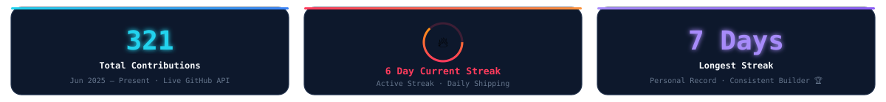
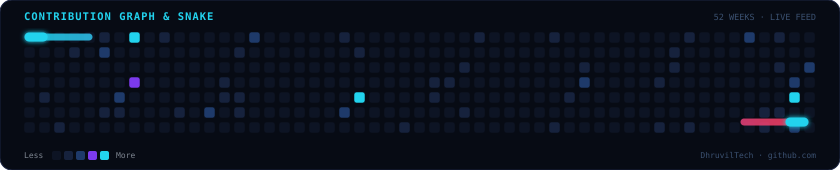
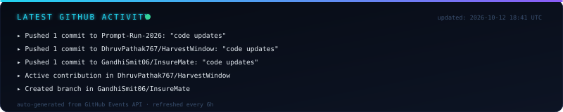

<!-- ╔══════════════════════════════════════════════════════════════════════╗
     ║  Dhruvil Dattani — GitHub Profile README                           ║
     ║  github.com/DhruvilTech                                            ║
     ║  Cyberpunk HUD · 3D Builder Pass · Live Real-Time Analytics        ║
     ║  Palette: bg #070b16  cyan #22d3ee  violet #8b5cf6  coral #ff354f ║
     ╚══════════════════════════════════════════════════════════════════════╝ -->

<a id="dhruvil-dattani"></a>

<!---------------------------------------------------------------------------->
<!-- HERO — Profile Showcase Card with Live 5-Phase Halftone Morph             -->
<!---------------------------------------------------------------------------->

<div align="center">

<picture>
  <source media="(prefers-color-scheme: light)" srcset="assets/hero-terminal.svg">
  
</picture>

<br/>

<!-- Dynamic Mission & Focus Typing Banner -->
<picture>
  <source media="(prefers-color-scheme: light)" srcset="assets/tagline.svg">
  
</picture>

<br/><br/>

<!-- QUICK ACTION & CONNECT BADGES -->
[](#contact)
[](#contact)
[](#awards)

<br/><br/>

<a href="mailto:dhruvildattani9@gmail.com">
  
</a>
&nbsp;
<a href="https://dhruvildattani-portfolio.vercel.app/" target="_blank">
  
</a>
&nbsp;
<a href="https://www.linkedin.com/in/dhruvil-dattani-b43599317/" target="_blank">
  
</a>
&nbsp;
<a href="https://github.com/DhruvilTech" target="_blank">
  
</a>

<br/>

> **🕐 Timezone:** IST (UTC +5:30) · Vadodara, Gujarat, India · **Available globally for high-impact engineering roles**

</div>

<br/>

<!-- ANIMATED SECTION DIVIDER -->
<div align="center">
  
</div>

<br/>

<!---------------------------------------------------------------------------->
<!-- 1. BUILDER CREDENTIALS — 3D HANGING LANYARD PASS & SKILLS RADAR          -->
<!---------------------------------------------------------------------------->

<a id="credentials"></a>

<div align="center">

<picture>
  <source media="(prefers-color-scheme: light)" srcset="assets/builder-pass.svg">
  
</picture>

</div>

<br/>

<!-- ANIMATED SECTION DIVIDER -->
<div align="center">
  
</div>

<br/>

<!---------------------------------------------------------------------------->
<!-- 2. ENGINEERING MINDSET & ARCHITECTURE PHILOSOPHY                          -->
<!---------------------------------------------------------------------------->

<a id="about"></a>

## 🧠 Engineering Mindset & Architecture Philosophy

<table>
<tr>
<td width="50%" valign="top">

### `01 / FROM THOUGHT TO THING`
## IDEAS. BUILT DIFFERENT.

> *"Most developers stop when the code runs locally. I don't consider anything built until it is deployed, secured, stress-tested, and delivering measurable utility to real people."*

- **Full-Stack Ownership:** Architecting every layer from MongoDB/PostgreSQL schemas to REST/FastAPI endpoints, clean React UI states, and cloud deployments.
- **AI That Solves Real Pains:** From diagnosing crop disease for Indian farmers (`KrishiMitra AI`) to automating code reviews (`CodeLens`) and career simulations (`InternX AI`).

</td>
<td width="50%" valign="top">

### `02 / CODE & INTELLIGENCE`
## MORE THAN A REPOSITORY.

> *"Engineering is about creating leverage. Combining LLMs, Computer Vision, and full-stack software to automate what was previously tedious or inaccessible."*

- **Real Systems Over Demos:** Production authentication (JWT + GitHub OAuth), role-based access control, automated PDF export pipelines, and forensic image analysis.
- **Continuous Shipping:** 27+ active repositories, daily commits, and relentless pursuit of performance and developer experience.

</td>
</tr>
</table>

<br/>

<!-- ANIMATED SECTION DIVIDER -->
<div align="center">
  
</div>

<br/>

<!---------------------------------------------------------------------------->
<!-- 3. FEATURED PRODUCTION PROJECTS                                           -->
<!---------------------------------------------------------------------------->

<a id="projects"></a>

## 🚀 Featured Production Projects

> **Engineering Standard:** Problem Identified → Architectural Solution → Measurable Real-World Impact

<br/>

| Project | Domain | Key Architecture | Live Artifact |
|---|---|---|:---:|
| 🔷 **InternX AI** | Career & Internship AI | `React` · `Node.js` · `MongoDB` · `Groq LLM` · `OAuth` | [View Details ↓](#internx-ai) |
| 🔶 **CodeLens AI** | Security & Code Review | `React` · `Monaco Editor` · `Express` · `Gemini API` | [View Details ↓](#codelens-ai) |
| 🟣 **KrishiMitra AI** | AgriTech & Multilingual AI | `YOLOv8` · `TensorFlow` · `FastAPI` · `Groq LLM` | [View Details ↓](#krishimitra-ai) |
| 🛡️ **DocShield AI** | Forensic Biometrics & KYC | `Computer Vision` · `OCR` · `FastAPI` · `Facial Biometrics` | [View Details ↓](#docshield-ai) |

<br/>

<a id="internx-ai"></a>

### 🔷 [InternX AI](https://github.com/DhruvilTech/InternX-AI) — AI-Powered Career & Virtual Internship Platform

<table>
<tr>
<td width="50%">

**Problem:** Students struggle to find relevant internships, prepare for technical interviews, and identify skill gaps — all without a unified AI-powered workflow.

**Solution:** Built a 4-portal full-stack platform (Student, Recruiter, College, Admin) with Groq LLM at the core — automating internship matching, mock interviews, skill-gap analysis, and career reports.

**Impact:** Replaced manual internship workflows with an end-to-end AI pipeline including GitHub OAuth, role-based access control, and automated PDF evaluations.

</td>
<td width="50%">

| Layer | Tech Stack |
|---|---|
| Frontend | `React.js` · `Tailwind CSS` |
| Backend | `Node.js` · `Express.js` |
| Database | `MongoDB` |
| AI Core | `Groq LLM` · `Fast AI Inference` |
| Auth & Security | `GitHub OAuth` · `JWT` · `RBAC` |

</td>
</tr>
</table>

<a href="https://github.com/DhruvilTech/InternX-AI">
  
</a>


---

<a id="codelens-ai"></a>

### 🔶 [CodeLens AI](https://github.com/DhruvilTech/CodeLens) — Intelligent Code Review Platform

<table>
<tr>
<td width="50%">

**Problem:** Code reviews are slow, inconsistent, and miss security vulnerabilities — especially for junior developers working solo.

**Solution:** Built a Monaco Editor-based platform backed by Google Gemini API that detects security holes, performance issues, and generates fix recommendations across JS, TS, Python, Java, and C++.

**Impact:** Supports multi-file upload, JWT auth, and exports reviews as PDF / CSV / JSON / Markdown — making every commit reviewable instantly.

</td>
<td width="50%">

| Layer | Tech Stack |
|---|---|
| Frontend | `React.js` · `Monaco Editor` |
| Backend | `Node.js` · `Express.js` |
| Database | `MongoDB` |
| AI Core | `Google Gemini API` |
| Auth | `JWT` |
| Export Pipeline | `PDF · CSV · JSON · Markdown` |

</td>
</tr>
</table>

<a href="https://github.com/DhruvilTech/CodeLens">
  
</a>


---

<a id="krishimitra-ai"></a>

### 🟣 [KrishiMitra AI](https://github.com/DhruvilTech/KrushiMitraAI) — Smart AI Farming & Multilingual Advisory

<table>
<tr>
<td width="50%">

**Problem:** Indian farmers lack real-time access to crop disease detection, weather-driven irrigation advice, and market insights — all in their native language.

**Solution:** Built a full-stack smart farming platform with an AI pipeline: YOLOv8 for visual disease detection, TensorFlow for crop prediction, FastAPI as the ML backend, and Groq LLM for multilingual recommendations.

**Impact:** GPS-based farm management, multilingual voice/text support, smart notifications, interactive analytics dashboards, and automated PDF report generation.

</td>
<td width="50%">

| Layer | Tech Stack |
|---|---|
| Frontend | `React.js` · `Tailwind CSS` |
| Backend | `Node.js` · `FastAPI (Python)` |
| AI / ML | `YOLOv8` · `TensorFlow` · `Groq LLM` |
| Capabilities | `GPS Farm Telemetry` · `Multilingual` · `PDF Export` |

</td>
</tr>
</table>

<a href="https://github.com/DhruvilTech/KrushiMitraAI">
  
</a>


---

<a id="docshield-ai"></a>

### 🛡️ [DocShield AI](https://github.com/DhruvilTech) — Intelligent Document Verification & Tampering Detection

<table>
<tr>
<td width="50%">

**Problem:** Manual document verification for KYC and identity auditing is slow, expensive, and frequently vulnerable to digital forgery, face mismatch, and deepfake tampering.

**Solution:** Built an end-to-end AI platform combining OCR-based document parsing, forensic image tampering detection, facial biometric matching, and automated risk scoring.

**Impact:** Provides instant verification verdict with visual forgery heatmaps, automated JSON/PDF audit reports, and multi-format document support.

</td>
<td width="50%">

| Layer | Tech Stack |
|---|---|
| Frontend | `TypeScript` · `React.js` |
| Backend | `Node.js` · `FastAPI (Python)` |
| AI / ML | `Computer Vision` · `OCR` · `Facial Biometrics` |
| Capabilities | `Tamper Heatmaps` · `Risk Scoring` · `PDF Audit Reports` |

</td>
</tr>
</table>

<a href="https://github.com/DhruvilTech">
  
</a>


<br/>

<div align="right">
  <a href="#dhruvil-dattani"><b><code>[ ⇡ Back to Top ]</code></b></a>
</div>

<br/>

<!-- ANIMATED SECTION DIVIDER -->
<div align="center">
  
</div>

<br/>

<!---------------------------------------------------------------------------->
<!-- 4. TECHNICAL ARSENAL & CORE TECH STACK                                    -->
<!---------------------------------------------------------------------------->

<a id="stack"></a>

## ⚡ Technical Arsenal & Core Stack

<!-- Fully Animated Skill Matrix & Arsenal -->
<div align="center">

<picture>
  <source media="(prefers-color-scheme: light)" srcset="assets/skills.svg">
  
</picture>

</div>

<br/>

### Languages
<div align="center">

</div>

### Frontend
<div align="center">

</div>

### Backend
<div align="center">

</div>

### AI / ML & LLMs
<div align="center">

&nbsp;

&nbsp;

&nbsp;

</div>

### Databases
<div align="center">

</div>

### Tools & DevOps
<div align="center">

</div>

<br/>

<!-- ANIMATED SECTION DIVIDER -->
<div align="center">
  
</div>

<br/>

<!---------------------------------------------------------------------------->
<!-- 5. LIVE GITHUB ANALYTICS & TELEMETRY RADAR                                -->
<!---------------------------------------------------------------------------->

<a id="analytics"></a>

## 📊 Live GitHub Analytics & Radar

<div align="center">

<!-- GitHub Stats Row: Total Contributions · Current Streak · Longest Streak -->
<picture>
  <source media="(prefers-color-scheme: light)" srcset="assets/stats-row.svg">
  
</picture>

<br/><br/>

<!-- Languages bar chart — LIVE from GitHub API -->
<picture>
  <source media="(prefers-color-scheme: light)" srcset="assets/languages.svg">
  
</picture>

</div>

<br/>

<!-- GitHub Stats + Top Languages cards -->
<div align="center">

<a href="https://github.com/DhruvilTech">
  
</a>
&nbsp;
<a href="https://github.com/DhruvilTech">
  
</a>

<br/><br/>

<a href="https://github.com/DhruvilTech">
  
</a>

</div>

<br/>

<!-- Contribution activity graph -->
<div align="center">

<a href="https://github.com/DhruvilTech">
  
</a>

</div>

<br/>

<!-- GitHub Trophies -->
<div align="center">

<a href="https://github.com/ryo-ma/github-profile-trophy">
  
</a>

</div>

<br/>

### Continuous Contribution Activity

<div align="center">



</div>

<br/>

### Live GitHub Activity Telemetry

<div align="center">

<picture>
  <source media="(prefers-color-scheme: light)" srcset="assets/now.svg">
  
</picture>

</div>

<br/>

<!-- ANIMATED SECTION DIVIDER -->
<div align="center">
  
</div>

<br/>

<!---------------------------------------------------------------------------->
<!-- 6. ENGINEERING PRINCIPLES & ARCHITECTURE STANDARDS                       -->
<!---------------------------------------------------------------------------->

<a id="principles"></a>

## 💡 Engineering Philosophy & Principles

```
▸ AI should solve real problems — KrishiMitra started with Indian farmers, not a tech demo.
▸ Security is not optional — CodeLens exists because I couldn't find a good free code reviewer.
▸ Full-stack means owning the pipeline: DB schema → API contract → UI → deployment.
▸ If it's not measurable, it's not done.
```

### 💬 Technical Discussions & Collaboration Areas

<table>
<tr>
<td>

- Integrating LLMs (Groq, Gemini) into production apps
- Building AI pipelines: YOLOv8 → FastAPI → React
- MERN stack architecture and MongoDB schema design
- JWT & OAuth flows (GitHub OAuth, role-based access)
- Code review automation with AI

</td>
<td>

- React.js performance and component patterns
- REST API design with Node.js + Express
- Computer Vision with YOLOv8 & TensorFlow
- DSA — practising daily for interviews
- Getting started with FastAPI (Python async APIs)

</td>
</tr>
</table>

<br/>

<!-- ANIMATED SECTION DIVIDER -->
<div align="center">
  
</div>

<br/>

<!---------------------------------------------------------------------------->
<!-- 7. HONORS & ACHIEVEMENTS                                                  -->
<!---------------------------------------------------------------------------->

<a id="awards"></a>

## 🏆 Honors & Key Achievements

| 🏆 | Achievement | Scope & Context |
|---|---|---|
| 🥇 | **Gujarat State Rank 90** | Diploma to Degree Common Entrance Test (DDCET) 2025 |
| 🏛️ | **Selected & Participated** | Code, Innovate & Impact Contest · **IIT Bombay** |
| ⚡ | **Offline Round Selected** | Odoo Gandhinagar Hackathon |
| 🚀 | **Prototype Building Round (Round 2)** | Bharat Academix CodeQuest Hackathon |

<br/>

<details>
<summary><b>Curious Facts & Personal Trivia</b> 🔍</summary>

<br/>

```
▸ Identity: Dhruvil Dattani · Full-Stack & AI Systems Engineer · Vadodara, India
▸ Track Record: Three production-level platforms engineered before graduating.
▸ Architecture: InternX AI built with 4 distinct portals and custom RBAC logic.
▸ Machine Learning: YOLOv8 + TensorFlow + FastAPI = favorite weekend toolset.
▸ Academic Rank: Gujarat State Rank 90 in DDCET (Lateral Engineering Entry).
▸ Mode: Dark mode non-negotiable. Always.
▸ Mission: Ship AI systems that deliver measurable utility to real people.
```

</details>

<br/>

<!-- ANIMATED SECTION DIVIDER -->
<div align="center">
  
</div>

<br/>

<!---------------------------------------------------------------------------->
<!-- 8. GET IN TOUCH & CONNECT                                                 -->
<!---------------------------------------------------------------------------->

<a id="contact"></a>

## 📬 Get in Touch & Connect

<div align="center">

<a href="mailto:dhruvildattani9@gmail.com">
  
</a>
&nbsp;
<a href="https://www.linkedin.com/in/dhruvil-dattani-b43599317/" target="_blank">
  
</a>
&nbsp;
<a href="https://github.com/DhruvilTech" target="_blank">
  
</a>
&nbsp;
<a href="tel:+919714415180">
  
</a>

<br/><br/>


<br/><br/>

<picture>
  <source media="(prefers-color-scheme: light)" srcset="assets/footer-wave.svg">
  
</picture>

<br/>

<sub>
  <code>Made with ☕ + code in Vadodara, Gujarat, India 🇮🇳</code>
  &nbsp;·&nbsp;
  <code>Stats auto-refreshed every 6h via GitHub Actions</code>
  &nbsp;·&nbsp;
  <code>Built by Dhruvil Dattani</code>
</sub>

</div>
